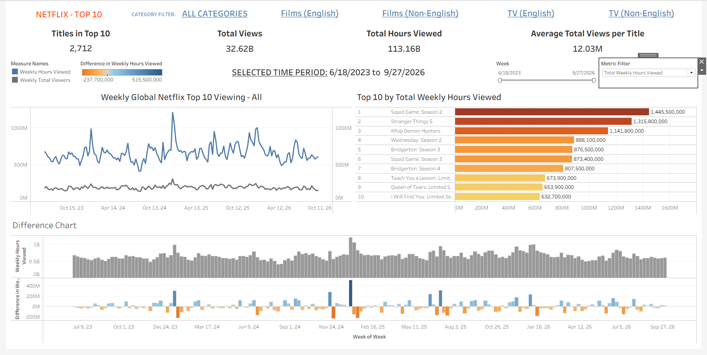

**Netflix Cultural Impact**

An analytics project exploring the relationship between Netflix viewing popularity and broader public interest.

**Research Question**

When a title becomes popular on Netflix, does broader public interest move with it?

The project uses Netflix Top 10 viewing data as the primary signal of streaming popularity and will eventually compare it with external indicators of public interest, such as Google Trends, Wikipedia pageviews, and other publicly available data.

The project is being developed in phases, beginning with a focused analysis of Netflix's global Top 10 data before adding geographic and external public-interest signals.

**Project Phases**
Phase 1 — Netflix Popularity Explorer

## Dashboard Preview

The first dashboard focuses exclusively on Netflix Global Top 10 data.

The goal is to understand:

How Netflix viewing popularity changes over time
Which titles drive viewing volume
How title performance differs across categories
How titles compare on viewing reach and total viewing volume
Which titles have the greatest longevity in the Top 10
Future Phases
Geographic Analysis: Use country-level Top 10 data to examine international patterns.
Public Interest Analysis: Compare Netflix viewing signals with Google Trends, Wikipedia pageviews, news, and other public-interest indicators.
Case Studies: Use the broader framework to investigate titles or events that show particularly interesting relationships between Netflix popularity and public interest.

External data is intentionally being added after the Netflix analysis rather than selecting case studies in advance.

**Data**

The project uses Netflix's publicly available Top 10 datasets:

Global weekly Top 10 data
Country-level weekly Top 10 data

The raw source files are intentionally excluded from this repository because they are large and periodically updated.

Global Data Model

The primary analytical grain is:

One record = one title/category/week

The cleaned global dataset contains:

week
category
weekly_rank
title
weekly_hours_viewed
weekly_views
cumulative_weeks_in_top_10

The cleaned global data begins on June 18, 2023, when Netflix's weekly views and runtime fields become consistently available.

**Analytical Datasets**

The Python pipeline currently produces two main analytical datasets:

global_clean.csv
    │
    ├── Timeline analysis
    │
    └── Title-level aggregation
             │
             └── title_metrics.csv
                    ├── Title rankings
                    └── Performance quadrant

Country-level data remains at its natural country/title/week grain and will be used in a later phase.

Phase 1 Dashboard

The first dashboard, Netflix Popularity Explorer, is designed around one central question:

How does Netflix Top 10 viewing popularity behave over time, and which titles drive that popularity?

Universal Filter

The dashboard will use a page-level Category filter:

All
Films (English)
Films (Non-English)
TV (English)
TV (Non-English)

The category selection will affect all dashboard components.

**KPI Metrics**

The initial KPI cards are:

Titles in Top 10 — Number of distinct titles appearing in the filtered data.
Total Views — Sum of weekly views across the filtered title-week records.
Total Hours Viewed — Sum of weekly hours viewed.
Average Weekly Views — Total weekly views divided by the number of title-week observations.
Median Weeks in Top 10 — Median number of Top 10 weeks per title.
Timeline

The primary visualization shows Netflix viewing popularity over time using the global title-week dataset.

Initial metrics:

Weekly Views
Weekly Hours Viewed

The timeline will use weekly aggregate values and will support interaction with the title-level analysis where appropriate.

Title Performance Quadrant

The quadrant compares titles using:

Average Weekly Views
Average Weekly Hours Viewed

Both measures are calculated over the weeks in which a title appears in the Top 10.

Quadrant thresholds will use the median of the currently filtered title population rather than arbitrary fixed thresholds.

The quadrant is intended to describe relative viewing performance, not to label audience behavior such as engagement or fan intensity.

Top Titles

A horizontal ranking chart will allow users to rank titles by different measures, including:

Total Views
Total Hours Viewed
Average Weekly Views
Average Weekly Hours Viewed
Weeks in Top 10
Peak Weekly Views
Peak Weekly Hours Viewed
Analytical Interactions

The intended interaction model is:

Category
   ↓
Dashboard metrics and charts
   ↓
Select a period or title
   ↓
Explore title-level performance over time

The objective is to create an analytical exploration experience rather than a collection of disconnected charts.

Analytical Considerations
Top 10 Scope

Netflix Top 10 data describes viewing among titles that appear in Netflix's published Top 10 rankings. It should not be interpreted as a measure of all Netflix viewing.

Views and Hours

Netflix's reported views and hours viewed are related measures because Netflix's view metric is derived using viewing hours and runtime. They should therefore not be treated as independent measures of audience behavior.

Correlation vs. Causation

The project is observational. Relationships between Netflix popularity and future external signals will be described as associations or changes occurring around the same period, not as proof that one caused the other.

Relative Thresholds

The title-performance quadrant uses medians of the currently selected population so that its thresholds adapt to the category being analyzed rather than relying on arbitrary universal cutoffs.

Project Structure
netflix_project/
├── Data/
│   ├── Raw/
│   │   ├── all-weeks-global.tsv
│   │   └── all-weeks-countries.tsv
│   └── Processed/
│       ├── global_clean.csv
│       └── title_metrics.csv
├── docs/
│   └── dashboard_spec.md
├── src/
│   ├── inspect_data.py
│   ├── clean_global_data.py
│   └── build_title_metrics.py
├── .gitignore
└── README.md

Raw and processed data files are excluded from Git by .gitignore.

Tools
Python
Pandas
Tableau
Git / GitHub

Additional tools and data sources will be added as the project develops.

**Current Progress**

~Load Netflix Top 10 global data with Python~

~Load Netflix Top 10 country data with Python~

~Profile dataset structure~

~Check for duplicate records~

~Check for missing values~

~Clean and validate global data~

~Create title-level metrics~

~Define Phase 1 dashboard~

~Explore metric distributions~

Build Phase 1 dashboard

Analyze geographic patterns

Integrate external public-interest data

Develop case studies

Complete final analytical write-up

Status

Phase 1 data preparation and dashboard specification are complete.

The next step is to validate the proposed metrics against the underlying distributions before building the visualization layer.
